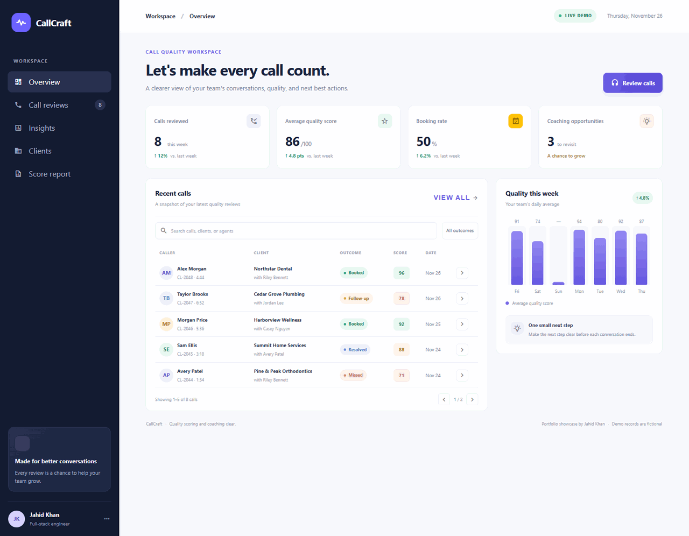
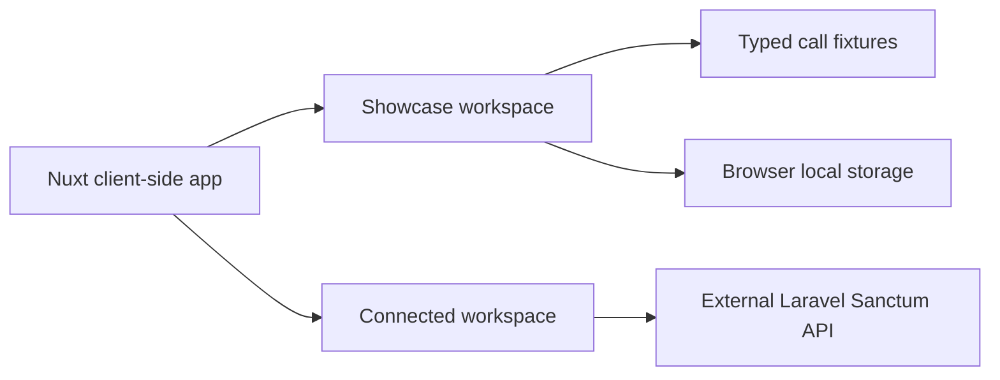

# CallCraft

CallCraft is a call-quality workspace for reviewers and coaching leads to score conversations consistently, find coaching opportunities, and track team performance.

[Run the demo](#getting-started) · [Architecture](#architecture) · [Try a review](#try-a-review) · [Quality checks](#quality-baseline)

## Showcase overview



## Key features

- Find calls by caller, business, call ID, or agent, then narrow the queue by client or outcome.
- Score greeting, discovery, resolution, and empathy and save a coaching note alongside the review.
- Open a client’s call history to see past conversations and review context in one place.
- Track quality trends and review outcomes, filter the score report by date window, and export the results to CSV.
- Preview the player controls with a simulated timeline and update the demo workspace profile.

## Tech stack

| Layer | Technology |
| --- | --- |
| Frontend | Nuxt 2, Vue 2, TypeScript, Vuetify 2, Vuex, and locally bundled Material Design icons |
| API integration | Axios and Nuxt Auth with an external Laravel Sanctum API |
| Demo data and storage | Typed TypeScript fixtures and browser local storage |
| Build and checks | Yarn Classic, Nuxt static generation, strict TypeScript, and Jest |

## Architecture



The showcase uses [typed fixtures and aggregation helpers](utils/showcase.ts). The dashboard lives in `pages/index.vue`, while the dedicated queue, clients, report, profile, scorecard, and player views share [WorkspacePage](components/showcase/WorkspacePage.vue). Connected mode uses the existing authentication and API integration.

## Engineering decisions

- **Bundle the demo records.** Reviewers can explore the main workflows without credentials or a running API. Demo activity is limited to the browser.
- **Persist saved changes locally.** Search, filters, and unsaved edits live in memory. Saved reviews and profile changes are written to browser storage when available. Demo views load saved reviews to reflect scoring changes across the workspace.
- **Keep connected mode available.** The mode flag selects the demo or the existing API-backed flows. The demo can be hosted as static files, while connected mode depends on a separately configured backend.

## Getting started

Use Node.js 22 and Yarn Classic 1.22. Run these commands from the repository root.

```sh
yarn install --frozen-lockfile
```

Copy the environment example using your shell.

```powershell
Copy-Item .env.example .env
```

```bash
cp .env.example .env
```

```sh
yarn dev
```

Open [the local showcase](http://localhost:3000). Keep `.env` local. Git ignores it.

### Configuration

| Variable | Purpose |
| --- | --- |
| `APP_NAME` | Sets the product name. Defaults to `CallCraft`. |
| `SHOWCASE_MODE` | Selects the local demo when `true` or connected mode when `false`. The example sets it to `true`. If omitted, the app selects showcase mode when no API URL is configured. |
| `API_BASE_URL` | Sets the external API base URL, including its `/api/v1` prefix when required. The example uses a localhost placeholder. |
| `BASE_URL_DEVELOPMENT`, `BASE_URL_STAGING`, `BASE_URL_PRODUCTION` | Legacy environment-specific API URLs used when `API_BASE_URL` is unset. |
| `RECAPTCHA_SITE_KEY` | Optional public site key. The reCAPTCHA plugin is disabled in the current Nuxt configuration. |

### Build the app

```sh
# Build for the configured mode
yarn build-prod

# Generate the static showcase into dist/
yarn generate-showcase
```

Nuxt embeds client configuration at build time. Keep secrets out of these variables.

## Try a review

1. Open `/calls`, search for `CL-2048`, and open the result. You can also go directly to `/call/CL-2048` or `/call?id=CL-2048`.
2. Adjust the four rubric scores, edit the coaching note, and save. Return to the queue or open `/reports/score-report` to see the saved result.
3. Open `/clients` for client history, `/player?call_id=CL-2048` for the playback preview, or `/profile` for the demo profile.

### Connected API

Set `SHOWCASE_MODE=false` and point `API_BASE_URL` at a reachable Laravel Sanctum backend. The frontend uses that API for authentication and CSRF, call review and scoring, blacklisting, client and location lookups, user metadata, and reporting. Run the backend separately.

## Quality baseline

```sh
npm run quality
yarn test --runInBand --coverage=false
yarn typecheck
```

`npm run quality` runs strict TypeScript checking, the full Jest suite, and a production showcase build. The tests cover demo fixtures, combined search and outcome filters, empty results, and score-summary calculations. Browser interactions and the connected API are outside this suite.

The [GitHub Actions workflow](.github/workflows/quality.yml) runs the same checks on pushes, pull requests, and merge queues with Node.js 22 and the frozen Yarn lockfile.

Enable the tracked pre-push hook once per clone after installing dependencies.

```sh
git config --local core.hooksPath .githooks
```

The hook checks the local working tree and stops the push if any command fails. To enforce the gate on GitHub, require a pull request and the **CallCraft quality** status check in the `main` branch ruleset after the first workflow run.

## Known limitations

- The showcase workspace uses fictional records and runs without a backend. Opening the connected sign-in or forgot-password routes directly can still trigger a CSRF request to the configured API.
- The player simulates playback controls and a timeline. It contains no call recording.
- Saved reviews and profile edits are scoped to the current browser and site origin. Clearing site data restores the fixtures, and review edits last only for the current session if browser storage is unavailable.

## License

[MIT](LICENSE)

## Author

Jahid Khan Tuhin — [GitHub](https://github.com/jahidkhantuhin) · [LinkedIn](https://www.linkedin.com/in/jahidkhantuhin/)
