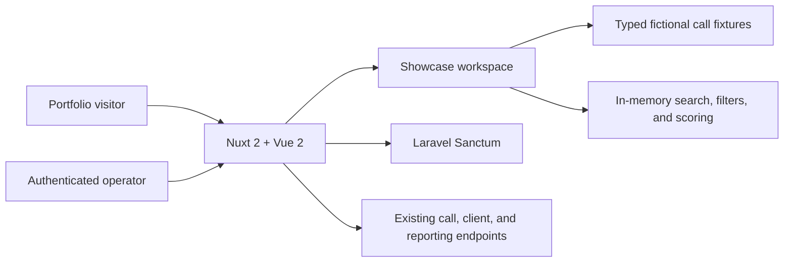

<div align="center">


# CallCraft

### Quality intelligence for every customer conversation.

**CallCraft** is a call-quality scoring and coaching workspace built to help teams review conversations consistently, coach with context, and improve customer experiences.

[Local demo](#run-the-showcase) · [Architecture](#how-it-fits-together) · [Configuration](#configuration) · [API mode](#connect-the-existing-api)

</div>

---

## What you can explore

- **A presentation-ready workspace** with a responsive overview, quality metrics, weekly trend, and coaching insights.
- **A searchable review queue** with outcome filters, pagination, caller and agent context, and score badges.
- **A client directory and call detail workspace** with per-client history, review context, an adjustable scorecard, and coaching notes.
- **Interactive insights and reports** with date windows, trend visuals, score summaries, and CSV export.
- **An editable workspace profile** and a playback-control preview that clearly identifies the sample audio as simulated.
- **An interactive scoring rubric** for greeting, discovery, resolution, and empathy. Adjust scores and coaching notes, then save them in browser storage.
- **Fictional, locally bundled records** so the showcase is useful without a backend, account, API key, or external recording.
- **Locally bundled Material Design icons** so navigation and action icons work without an external font CDN.
- **A backend-connected mode** that keeps the existing Laravel Sanctum authentication and call-review API integration available.
- **Configurable product branding and API endpoints**; no organization-specific service URL or CAPTCHA site key is embedded in the presentation UI.

> **Demo data notice:** the CallCraft showcase uses synthetic names, clients, call summaries, and scores. It does not send demo interactions to a server or play a customer recording. Review and profile edits are stored in the browser's local storage; clearing browser storage resets them.

## Run the showcase

### Requirements

- Node.js 22 LTS
- Yarn Classic 1.22

### Start locally

```bash
# From the project root
yarn install --frozen-lockfile
copy .env.example .env
yarn dev
```

Open [http://localhost:3000](http://localhost:3000). The default local configuration opens the CallCraft showcase without contacting an API.

For PowerShell, `copy .env.example .env` works in the project directory. Keep `.env` local; it is ignored by Git.

### Try the review experience

1. Search for a caller, business, call ID, or agent.
2. Filter the queue by outcome and switch between **Overview**, **Call reviews**, and **Insights**.
3. Open a row, adjust its four quality dimensions, edit the coaching note, and save.
4. See the updated score and review state reflected in the overview, call queue, client view, and report.
5. Browse **Clients**, **Insights & reports**, and **Profile** from the workspace navigation; open a call to adjust its rubric and visit its player preview.

The portfolio workspace includes the `/`, `/calls`, `/clients`, `/reports/score-report`, `/profile`, `/call?id=…`, and `/player?call_id=…` routes. Authenticated sign-in and password-reset flows are retained unchanged for connected API mode; they are intentionally not simulated by the public demo.

## Configuration

The checked-in `.env.example` is safe to copy and contains no credentials.

| Variable                                                          | Purpose                                                                                     | Default                                                          |
| ----------------------------------------------------------------- | ------------------------------------------------------------------------------------------- | ---------------------------------------------------------------- |
| `APP_NAME`                                                        | Product name used in the page title and authentication/player surfaces                      | `CallCraft`                                                      |
| `SHOWCASE_MODE`                                                   | `true` shows the local interactive showcase; `false` uses the existing API-backed home page | Automatically enabled when no API URL is configured              |
| `API_BASE_URL`                                                    | Base URL for the existing API, including its `/api/v1` prefix when required                 | Localhost placeholder; no API requests are made in showcase mode |
| `BASE_URL_DEVELOPMENT`, `BASE_URL_STAGING`, `BASE_URL_PRODUCTION` | Backward-compatible per-environment API URL fallbacks                                       | Unset                                                            |
| `RECAPTCHA_SITE_KEY`                                              | Optional public site key for the dormant reCAPTCHA plugin                                   | Unset                                                            |

For a backend-connected local session, configure a reachable Laravel API, then set:

```dotenv
SHOWCASE_MODE=false
API_BASE_URL=http://localhost:8000/api/v1
```

Use the API host and credentials supplied by your own backend environment. Do not commit `.env` or private credentials. If `API_BASE_URL` is unset, the app still accepts the legacy `BASE_URL_<ENVIRONMENT>` variables; the localhost fallback exists only so the Sanctum module can initialize in standalone showcase builds.

## Production and static builds

```bash
# Nuxt production build
yarn build-prod

# Generate a static site
yarn generate-showcase
```

Environment values are embedded into the generated client bundle at build time. For a public, backend-free showcase, build with `SHOWCASE_MODE=true`; do not include private service credentials in public build variables. The production static site is suitable for a static host that serves the generated `dist/` directory.

## How it fits together



The showcase renders local fixture-backed views for the dashboard, call queue, clients, reports, profile, call details, and player. Its typed fixtures and filtering/summary functions live in `utils/showcase.ts`, with reusable demo pages in `components/showcase/WorkspacePage.vue`. Showcase-mode authentication middleware skips API redirects for these demo routes; connected-mode auth pages and API-backed flows remain in place. The dedicated `showcase` layout provides shared navigation, and the Material Design icon font is bundled locally.

### Project map

```text
assets/       Global styles and Vuetify theme variables
components/   Reusable UI, forms, call-scoring, and showcase components
layouts/     Authenticated application, blank, and showcase shells
middleware/  Existing authentication and role checks
pages/       Nuxt routes; / is the local portfolio showcase when enabled
plugins/     Axios, validation, date, and optional integration plugins
services/    API access helpers
store/       Vuex state for calls, users, permissions, and theme
test/        Jest tests for presentation data and calculations
utils/       Typed showcase fixtures and shared helpers
```

## Connect the existing API

This repository is a frontend client, not a standalone API server. Backend-connected routes expect a reachable Laravel Sanctum API. The current client calls include authentication/CSRF, call list/detail/scoring/blacklisting, user metadata, client/location lookups, and reporting. Endpoint paths and request/response behavior were not changed for this showcase update.

The browser demo deliberately does not pretend that its local save action is a server-side write or that sample playback contains real audio. In API mode, the existing `/calls`, client, reporting, and call-scoring flows continue to use the configured API and authenticated user. Auth/login/password-reset routes remain available as existing API-connected screens but are not part of the standalone showcase journey.

## Quality checks

```bash
yarn test --runInBand
yarn typecheck
```

The tests cover the synthetic fixture set, case-insensitive search and outcome filtering, aggregate metrics, and the empty-results case. The type check runs the project's strict TypeScript configuration.

## Implementation notes

- **Current application stack:** Nuxt 2, Vue 2, TypeScript, Vuetify 2, Vuex, and Jest. This is an incremental product improvement, not a framework migration; the API integration and existing authenticated routes are preserved.
- **No API contract change:** no new endpoint, request, response, or external API dependency was introduced.
- **Privacy by default:** the local showcase has no analytics, remote demo-data fetch, or real recording dependency.
- **Repository name:** `call-craft-quality-coaching` is the intended GitHub repository slug. The configured Git remote is intentionally unchanged.
